<!-- ========================= HEADER ========================= -->
<div align="center">


### 🎓 Computer Hardware • IT Support • Networking • Operating Systems • Office Productivity • Digital Marketing • EdTech

<p>
  
  
  
  
</p>

<!-- ========================= NAV BAR ========================= 
<p>
  <a href="#academic"><b>📑 Academic</b></a> &nbsp;|&nbsp;
  <a href="#microsoft"><b>💻 Microsoft</b></a> &nbsp;|&nbsp;
  <a href="#cisco"><b>🌐 Cisco</b></a> &nbsp;|&nbsp;
  <a href="#google"><b>📊 Google & Coursera</b></a> &nbsp;|&nbsp;
  <a href="#university"><b>🏫 University</b></a>
</p>
-->
</div>

---

<!-- ========================= ABOUT ========================= -->
<div align="center">

## 👋 Welcome

</div>

Welcome to my repository of academic achievements and professional certifications.
This portfolio showcases my journey in **Computer Hardware, IT Support, Networking, Operating Systems, Office Productivity, Digital Marketing, Educational Technology and AI in Education**.

<div align="center">

| 🏆 Certifications | 🏢 Providers | 🛠️ Focus Areas |
|:---:|:---:|:---:|
| **15+** | **Microsoft • Cisco • Google • UoM** | **IT • AI • Web • Marketing** |

</div>

---

<!-- ========================= ACADEMIC ========================= -->
<a id="academic"></a>
<div align="center">

## 📑 Academic Qualifications


<br><br>

<table>
  <tr>
    <td align="center" width="33%">
      <b>G.C.E. (O/L) Examination – 2021</b><br><br>
      <a href="academic/OL-Results.jpg">
        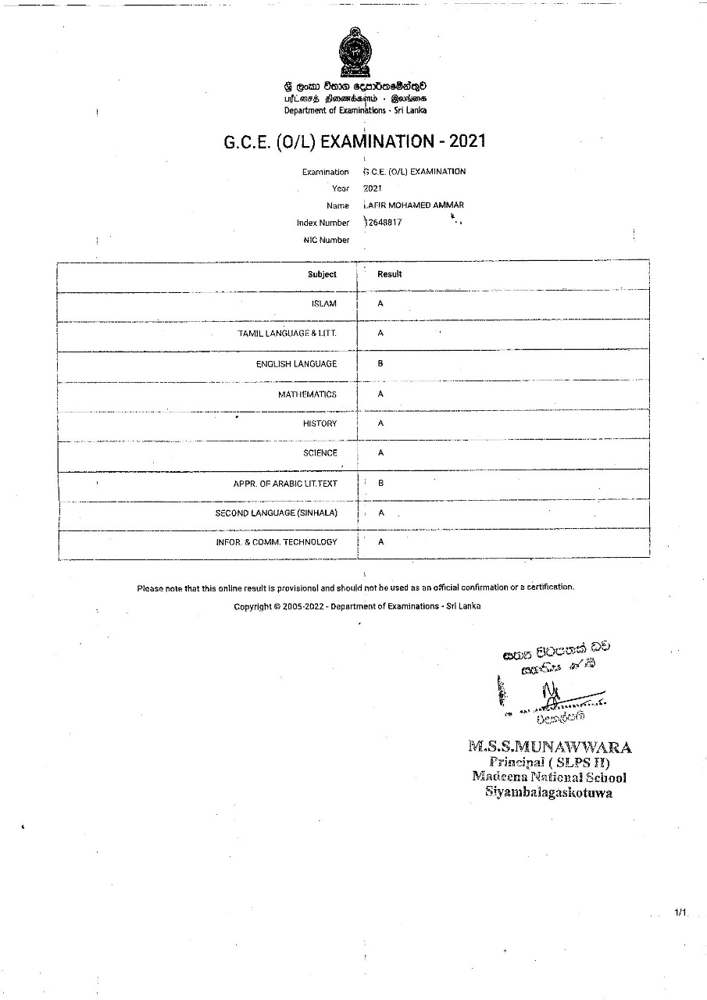
      </a>
    </td>
    <td align="center" width="33%">
      <b>Diploma in Computer Application</b><br>
      <sub>Fusion Education</sub><br><br>
      <a href="academic/Diploma_in_Computer_Applications.jpg">
        
      </a>
    </td>
    <td align="center" width="33%">
      <b>Youth Leadership & Participation</b><br>
      <sub>Y Clubs 2024</sub><br><br>
      <a href="academic/youth-club.jpeg">
        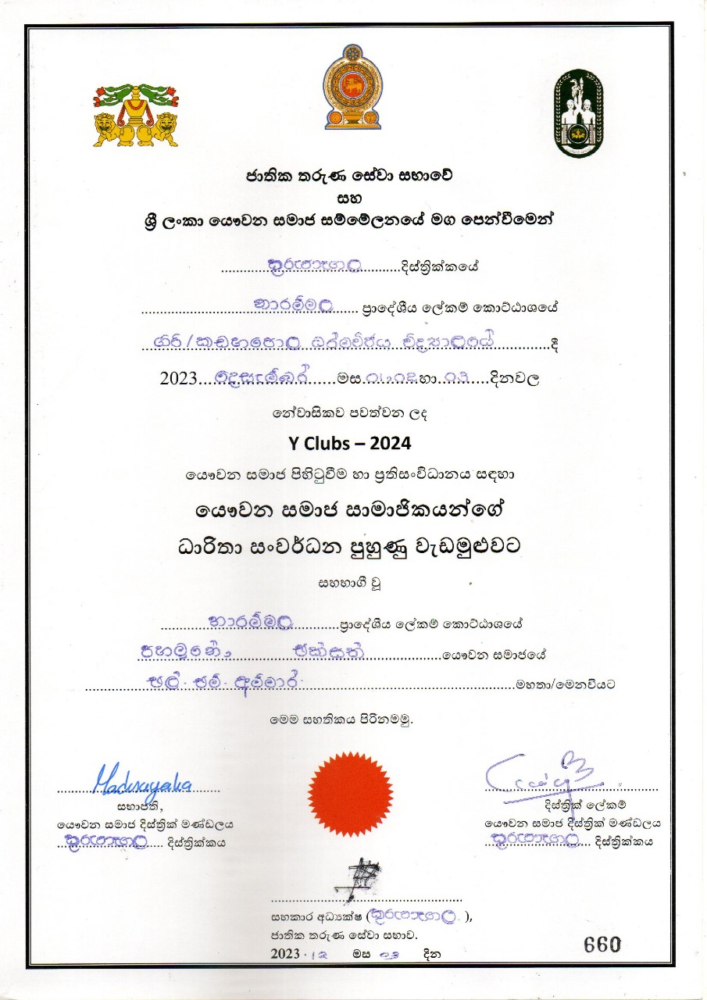
      </a>
    </td>
  </tr>
</table>

</div>

---

<!-- ========================= MICROSOFT ========================= -->
<a id="microsoft"></a>
<div align="center">

## 💻 Professional Certifications – Microsoft


<br><br>

### 🟢 Microsoft Office Specialist (MOS)

<table>
  <tr>
    <td align="center" width="50%">
      <b>Excel 2016</b><br>
      <sub>📅 Nov 2, 2022</sub><br><br>
      <a href="microsoft/MOS-Excel.png">
        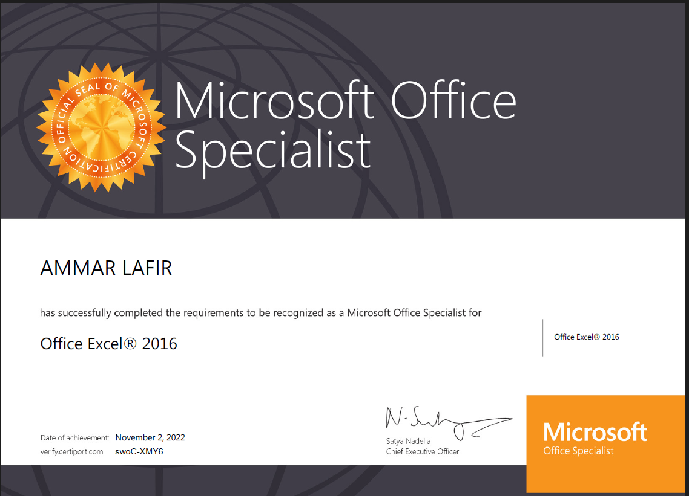
      </a>
    </td>
    <td align="center" width="50%">
      <b>Word 2016</b><br>
      <sub>📅 Dec 21, 2022</sub><br><br>
      <a href="microsoft/MOS-Word.png">
        
      </a>
    </td>
  </tr>
</table>

<br>

### 🪟 MD-100 – Windows Client

<table>
  <tr>
    <td align="center" width="50%">
      <b>Support the Windows Client Environment</b><br><br>
      <a href="microsoft/Achievements-MD-100-Windows.png">
        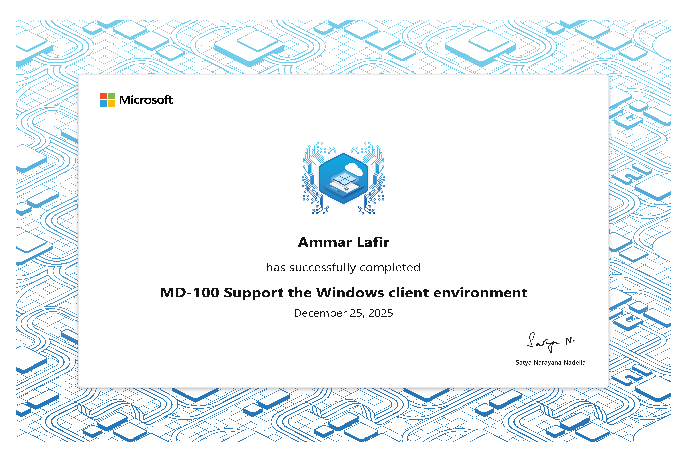
      </a>
    </td>
    <td align="center" width="50%">
      <b>Troubleshoot the Windows Client OS and Apps</b><br><br>
      <a href="microsoft/Achievements-MD-100-WINDOWS_OS-and-APP.png">
        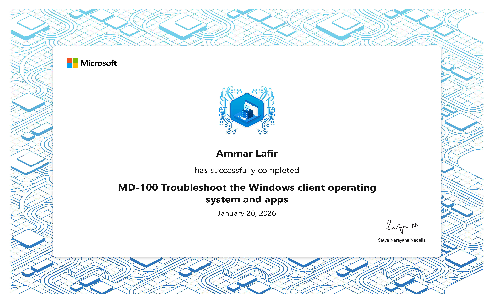
      </a>
    </td>
  </tr>
</table>

<br>

### 🤖 AI for Educators

<table>
  <tr>
    <td align="center">
      <b>Empower Educators to Explore the Potential of Artificial Intelligence</b><br><br>
      <a href="microsoft/AI-for-EDUCATOR.jpg">
        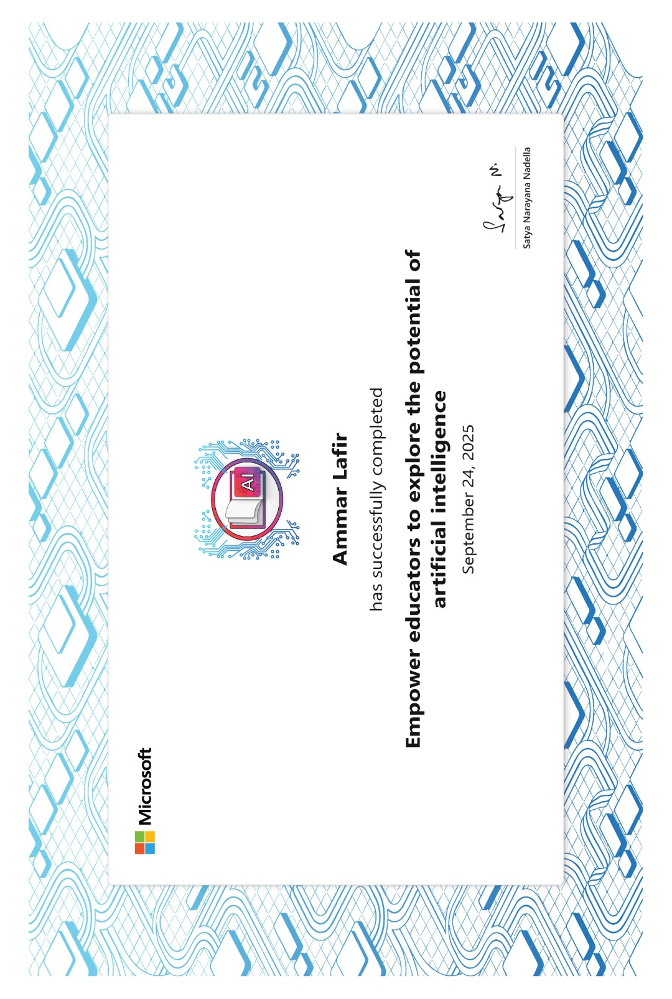
      </a>
    </td>
  </tr>
</table>

</div>

---

<!-- ========================= CISCO ========================= -->
<a id="cisco"></a>
<div align="center">

## 🌐 Professional Certifications – Cisco Networking Academy


<br>

<sub>📌 For each course: the <b>left</b> image is the <b>official certificate</b>, and the <b>right</b> image lists the <b>skills gained</b> in that course.</sub>

<br><br>

### 🎧 IT Customer Support Basics

<table>
  <tr>
    <th align="center" width="50%">🏅 Certificate</th>
    <th align="center" width="50%">🧠 Skills Gained</th>
  </tr>
  <tr>
    <td align="center">
      <a href="cisco/IT-SUP(1).png">
        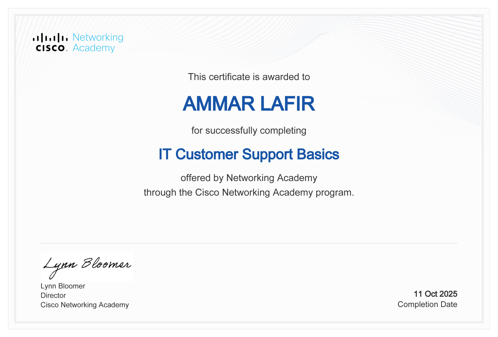
      </a>
    </td>
    <td align="center">
      <a href="cisco/IT-SUP(2).png">
        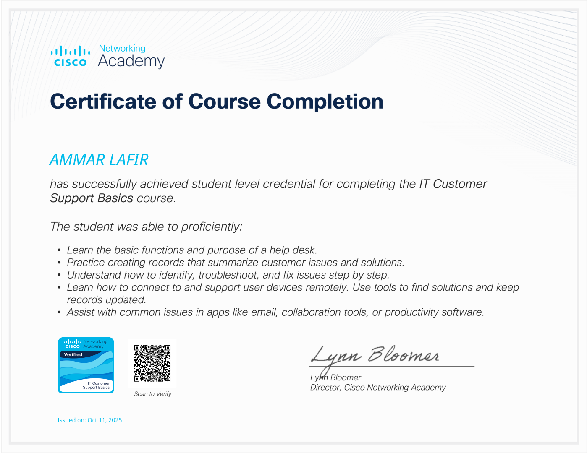
      </a>
    </td>
  </tr>
</table>

<br>

### 🖥️ Operating Systems Support

<table>
  <tr>
    <th align="center" width="50%">🏅 Certificate</th>
    <th align="center" width="50%">🧠 Skills Gained</th>
  </tr>
  <tr>
    <td align="center">
      <a href="cisco/OS-SUP(1).png">
        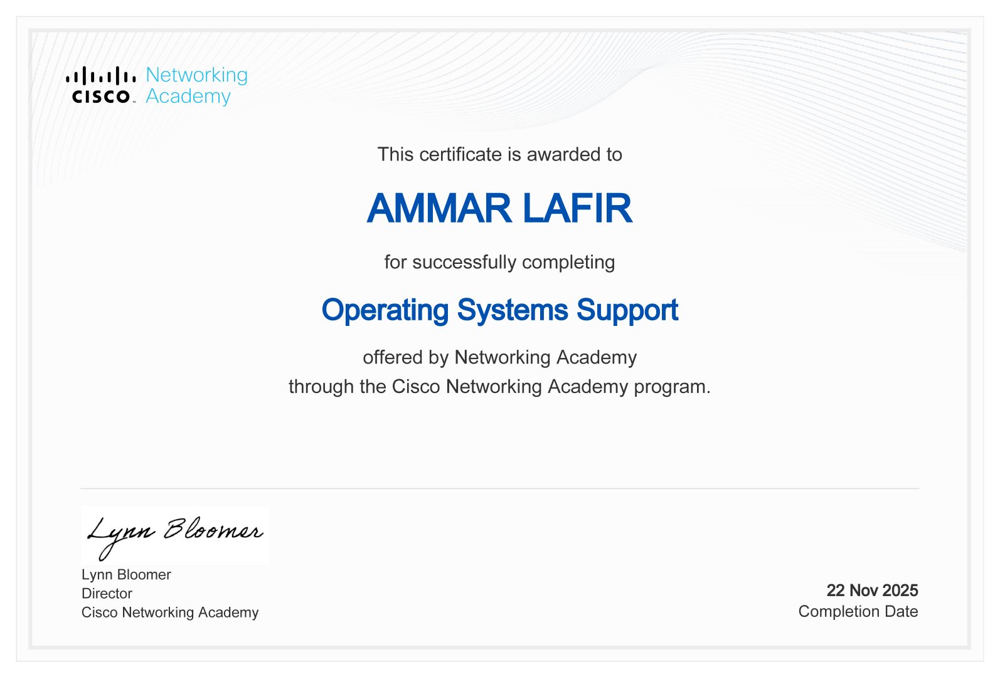
      </a>
    </td>
    <td align="center">
      <a href="cisco/OS-SUP(2).png">
        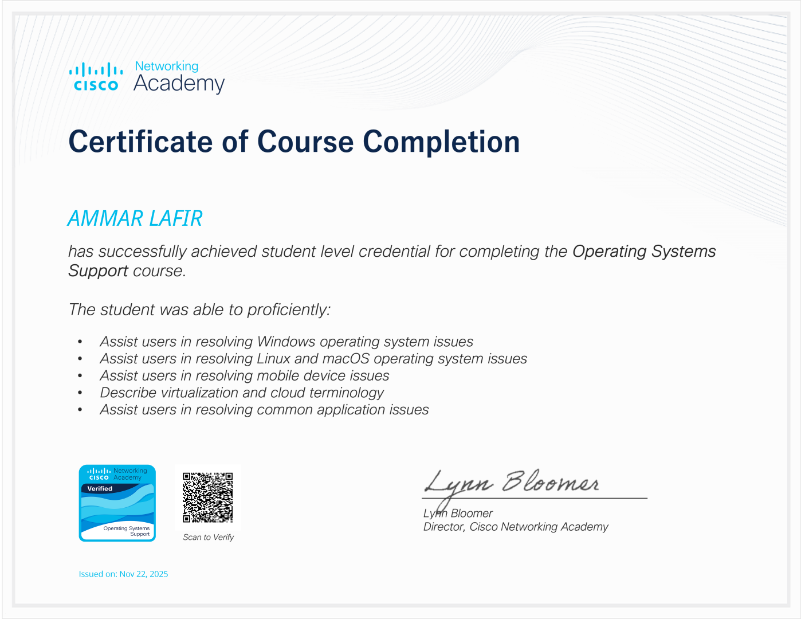
      </a>
    </td>
  </tr>
</table>

<br>

### 🔐 Security and Connectivity Support

<table>
  <tr>
    <th align="center" width="50%">🏅 Certificate</th>
    <th align="center" width="50%">🧠 Skills Gained</th>
  </tr>
  <tr>
    <td align="center">
      <a href="cisco/security_and_connectivity.png">
        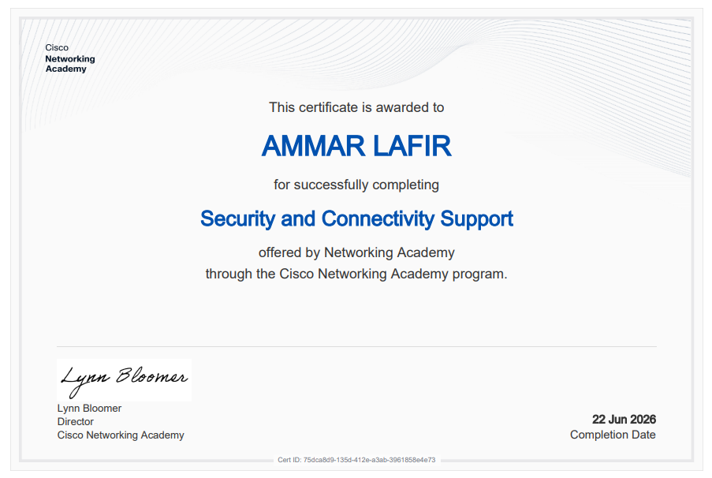
      </a>
    </td>
    <td align="center">
      <a href="cisco/security_and_connectivity_details.png">
        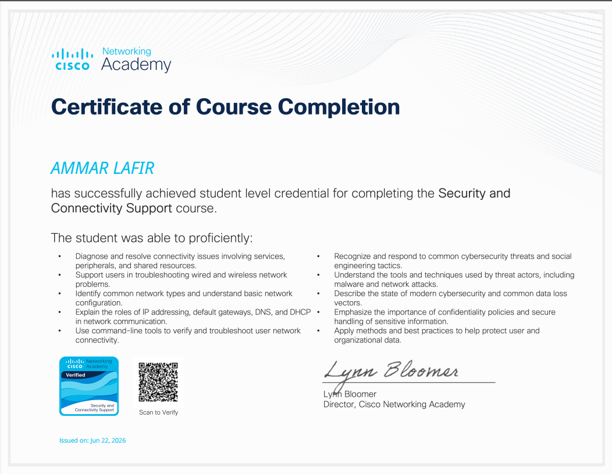
      </a>
    </td>
  </tr>
</table>

</div>

---

<!-- ========================= GOOGLE ========================= -->
<a id="google"></a>
<div align="center">

## 📊 Professional Certifications – Google & Coursera


<br><br>

<table>
  <tr>
    <td align="center">
      <b>Foundations of Digital Marketing and E-commerce</b><br><br>
      <a href="google-coursera/Google-DM.png">
        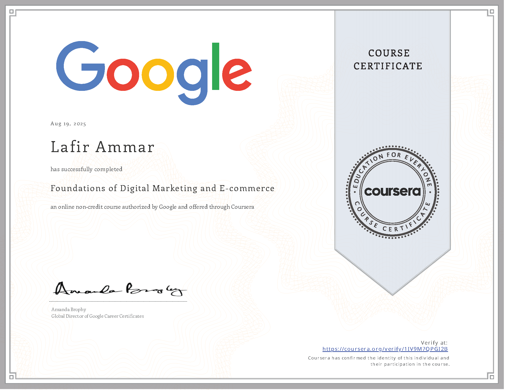
      </a>
      <br><br>
      <a href="https://coursera.org/verify/11V9M70PGI2B">
        
      </a>
    </td>
  </tr>
</table>

</div>

---

<!-- ========================= UNIVERSITY ========================= -->
<a id="university"></a>
<div align="center">

## 🏫 University & Institutional Programs


<br><br>

<table>
  <tr>
    <td align="center">
      <b>Front-End Web Development</b><br>
      <sub>University of Moratuwa (CODL)</sub><br><br>
      <a href="university/Front-End_Web_Development_E-Certificate.png">
        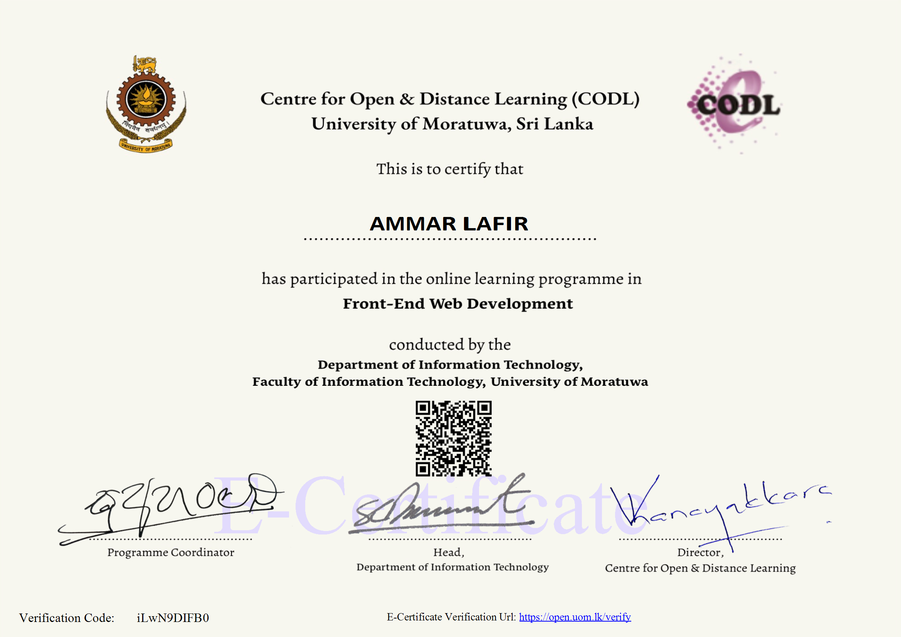
      </a>
    </td>
  </tr>
</table>

</div>

---

<!-- ========================= STRUCTURE ========================= -->
## 📂 Repository Structure

<details>
<summary><b>Click to expand</b></summary>

<br>

```text
📁 certifications-portfolio
 ┣ 📄 README.md
 ┣ 📁 academic/
 ┣ 📁 microsoft/
 ┣ 📁 cisco/
 ┣ 📁 google-coursera/
 ┗ 📁 university/
```

</details>

---

<!-- ========================= FOOTER ========================= -->
<div align="center">

<b>⭐ Thanks for visiting my portfolio! ⭐</b>

<br>

<a href="#top"></a>


</div>
